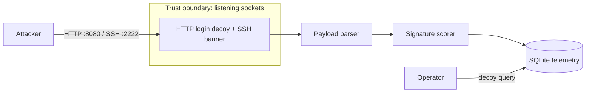

# decoy

Automated honeypot: an emulated HTTP login plus a thin SSH identification banner.
Incoming payloads are parsed, scored against defensive threat signatures, and
stored as structured telemetry in SQLite. A small CLI queries that telemetry.

This is a **decoy**. The HTTP form never authenticates anyone. The SSH listener
is not an SSH stack — it only sends a banner, reads a little client data, and
closes.

## Architecture



Everything past the sockets is untrusted input. See [THREAT_MODEL.md](THREAT_MODEL.md).

## Requirements

- Python 3.11+
- No runtime dependencies (stdlib only)
- `pytest` and `pytest-cov` for tests

## Install and run

```bash
python3 -m venv .venv
source .venv/bin/activate
python -m pip install -e ".[dev]"
decoy serve
```

Or without installing:

```bash
make run
```

Listeners:

| Surface | Default | Behavior |
| --- | --- | --- |
| HTTP | `:8080` | `GET /` fake login form; `POST /login` captures fields and always fails auth |
| SSH | `:2222` | Send an OpenSSH identification string, read a bit of data, close |

Environment (all optional):

| Variable | Default | Meaning |
| --- | --- | --- |
| `DECOY_BIND` | `0.0.0.0` | Bind address |
| `DECOY_HTTP_PORT` | `8080` | HTTP port |
| `DECOY_SSH_PORT` | `2222` | SSH banner port |
| `DECOY_DB` | `decoy.db` | SQLite path |
| `DECOY_RATE_WINDOW` | `60` | Rate-window seconds |
| `DECOY_RATE_THRESHOLD` | `20` | Hits in-window that trip `high_request_rate` |

## Query telemetry

```bash
decoy query
decoy query --min-score 20 --proto http
decoy query --proto ssh --json --limit 50
decoy query --db /data/decoy.db
```

Each event stores timestamp, source address, protocol, path, integer score,
reason list, SHA-256 of the captured payload, and a length-capped snippet.
Password-looking form values of length ≥ 3 are replaced with `***` in the
snippet. Do not point this at real user databases or production credentials.

## Scoring (detections only)

Integer score plus a list of reasons. Matchers are defensive signatures, not
exploit write-ups:

- default / common credential names
- SQL metacharacters in fields
- path-traversal tokens
- scanner User-Agents (`nikto`, `sqlmap`, `nmap`, `masscan`, `zgrab`)
- empty or missing User-Agent
- optional high request rate per source IP
- SSH banner probes (base `ssh_probe` reason)

## Tests

```bash
make test
```

Coverage must stay at or above 80% on `src/decoy`.

## Docker

```bash
docker compose up --build
```

That starts both listeners (`8080` and `2222`) in one container. Telemetry
persists in the `decoy-data` volume.

## License

MIT. Copyright (c) 2026 smae.
